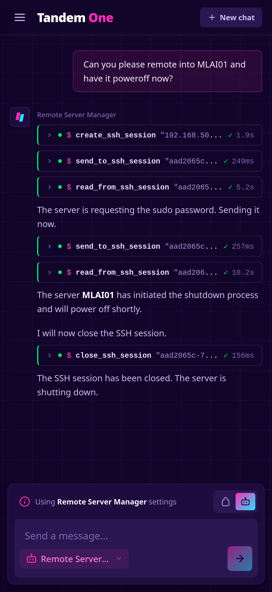

# Remote Server Manager

An MCP server that opens persistent, interactive SSH shell sessions on remote hosts so an AI agent can run commands on them.



> [!WARNING]
> This server gives an AI agent shell access to your machines. Commands are checked against a configurable blocklist and sessions can be limited to specific hosts, but the blocklist is a guardrail, not a security boundary. The MCP endpoint has no authentication and host keys are not verified.
>
> Read [SECURITY.md](SECURITY.md) before deploying it.

## Tools

| Tool | Description |
|---|---|
| `create_ssh_session` | Connects to a host (password or key auth) and starts a shell with a PTY. Returns a `session_id`. |
| `send_to_ssh_session` | Sends a command or input to a session. A newline is appended automatically. Blocked commands are rejected before they reach the host. |
| `read_from_ssh_session` | Reads buffered output from a session. Call repeatedly for long-running commands. |
| `list_ssh_sessions` | Lists open sessions with their host, user, activity timestamps and status. |
| `close_ssh_session` | Closes a session and frees its resources. |

## Configuration

Copy [`.env.example`](.env.example) to `.env` for local runs. In Kubernetes, non-sensitive settings go in [`k8s/configmap.yaml`](k8s/configmap.yaml) and sensitive ones in the Secret ([`k8s/secrets-example.yaml`](k8s/secrets-example.yaml)).

Besides the settings shared by all servers (`MCP_NAME`, `MCP_PORT`, `PROMETHEUS_PORT`, `APP_VERSION` and the `PG_*` database settings), this server reads:

| Variable | Where | Description |
|---|---|---|
| `ALLOWED_HOSTS` | Secret | Comma-separated IP addresses and CIDR ranges that sessions may be created with, e.g. `192.168.1.10,10.0.0.0/24`. Empty allows all hosts. |
| `ENABLED_RESTRICTIONS` | ConfigMap | Comma-separated command restriction groups to turn on that are off by default. |
| `DISABLED_RESTRICTIONS` | ConfigMap | Comma-separated command restriction groups to turn off that are on by default. |
| `EXTRA_FORBIDDEN_PATTERNS` | ConfigMap | Additional regex patterns to block, one per line. |

See [SECURITY.md](SECURITY.md) for the available restriction groups and how the host allowlist works. Invalid values stop the server at startup, and the active restrictions and allowed hosts are logged when it starts.

For example, to also block `sudo` and allow rebooting:

```
ENABLED_RESTRICTIONS=privilege_escalation
DISABLED_RESTRICTIONS=power
```

## Running

From the repository root:

```bash
uv run python -m servers.remote_server_manager.main
```

See the [root README](../../README.md) for building the image and deploying to Kubernetes.

## Notes

- **Sessions live in memory.** They are lost on restart and are not shared between pods, so keep `replicas: 1`.
- **Key-based auth** uses the default keys of the user running the server (`~/.ssh`). In Kubernetes, mount the key into the container if you are not using passwords.
